<p align="center">
  
</p>

<h1 align="center">CoverWall</h1>

<p align="center">
  <strong>Turn album artwork into device-ready wallpapers.</strong>
</p>

<p align="center">
  Native SwiftUI for iPhone, iPad, and Mac.<br>
  Search the iTunes catalog, pull high-resolution cover art, generate four wallpaper styles — save or share.
</p>

## Features

- Search albums and songs via the public iTunes Search API (US storefront)
- Fetch high-resolution artwork by rewriting the CDN size token (`100x100bb` → `3000x3000bb`); the CDN never upscales past the original
- Generate **four wallpapers in one pass** for the selected device target:
  - **Smart Crop** — content-aware framing; the original fills the canvas
  - **Mirror + Blur** — sharp center plate over a soft mirrored atmosphere
  - **Frequency Separation** — low-frequency color field with a protected, sharpened foreground
  - **Blur Fill** — full-bleed short side, top-weighted haze, ambient depth grade
- Save to the photo library, system Share sheet, or (on Mac) save as a JPEG file
- Interface localized in **English** and **简体中文**

## Examples

Demo source art is an **original illustration for documentation only** (not a real album). All wallpapers below were produced by this repo’s `WallpaperGenerator` via `Tools/GenerateReadmeExamples`.

<table>
  <tr>
    <td align="center" width="22%">
      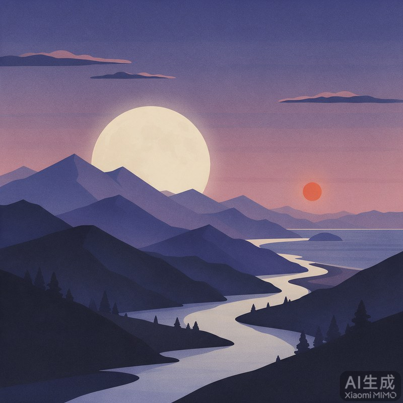<br>
      <sub><b>Source cover</b><br>1600 × 1600</sub>
    </td>
    <td align="center" width="26%">
      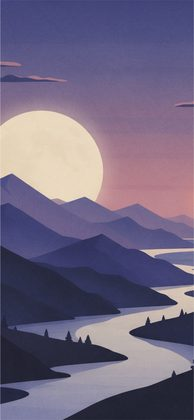<br>
      <sub><b>Smart Crop</b><br>iPhone 1179 × 2556</sub>
    </td>
    <td align="center" width="26%">
      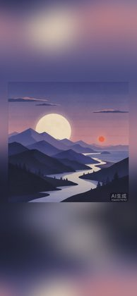<br>
      <sub><b>Mirror + Blur</b><br>iPhone 1179 × 2556</sub>
    </td>
    <td align="center" width="26%">
      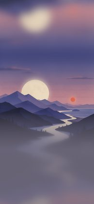<br>
      <sub><b>Blur Fill</b><br>iPhone 1179 × 2556</sub>
    </td>
  </tr>
</table>

### Four styles on each target

<table>
  <tr>
    <td align="center"><br><sub>Smart Crop</sub></td>
    <td align="center"><br><sub>Mirror + Blur</sub></td>
    <td align="center">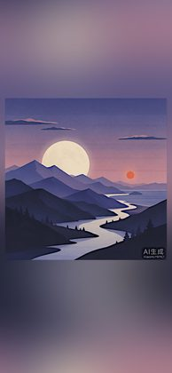<br><sub>Frequency Separation</sub></td>
    <td align="center"><br><sub>Blur Fill</sub></td>
  </tr>
  <tr>
    <td align="center" colspan="4"><sub><b>iPhone</b> · 1179 × 2556</sub></td>
  </tr>
  <tr>
    <td align="center">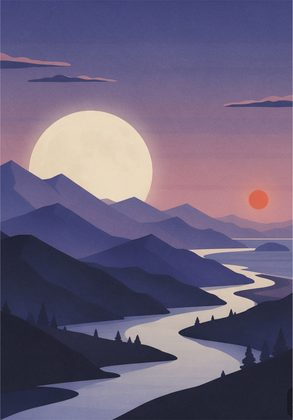<br><sub>Smart Crop</sub></td>
    <td align="center">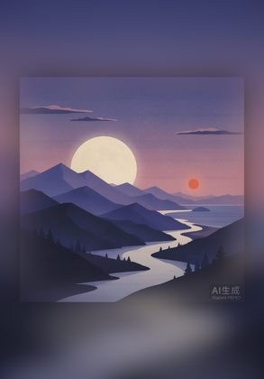<br><sub>Mirror + Blur</sub></td>
    <td align="center">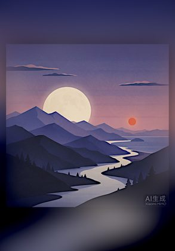<br><sub>Frequency Separation</sub></td>
    <td align="center">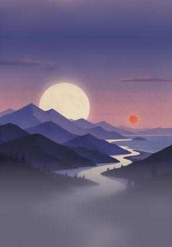<br><sub>Blur Fill</sub></td>
  </tr>
  <tr>
    <td align="center" colspan="4"><sub><b>iPad</b> · 1668 × 2388</sub></td>
  </tr>
  <tr>
    <td align="center" colspan="2">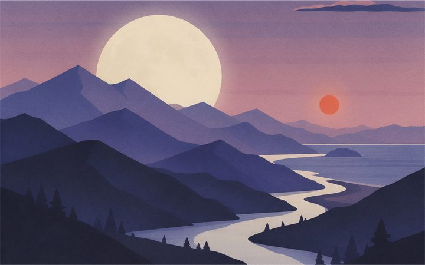<br><sub>Smart Crop</sub></td>
    <td align="center" colspan="2">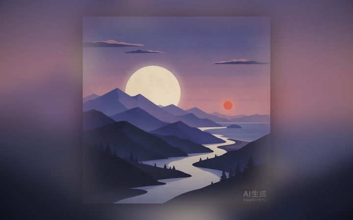<br><sub>Mirror + Blur</sub></td>
  </tr>
  <tr>
    <td align="center" colspan="2">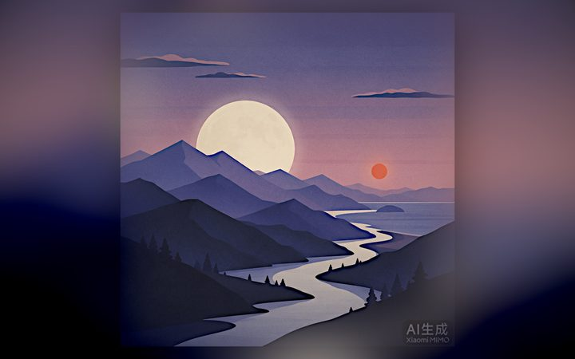<br><sub>Frequency Separation</sub></td>
    <td align="center" colspan="2">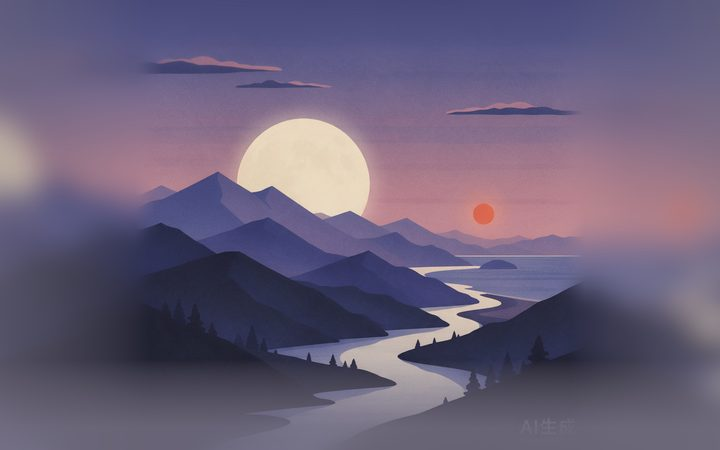<br><sub>Blur Fill</sub></td>
  </tr>
  <tr>
    <td align="center" colspan="4"><sub><b>Mac</b> · 2880 × 1800</sub></td>
  </tr>
</table>

Full-resolution JPEGs live in [`Docs/Examples/`](Docs/Examples) (open any file for the export size). Regenerate after algorithm changes:

```bash
swiftc -O -o /tmp/cw-examples \
  CoverWall/Models.swift CoverWall/WallpaperGenerator.swift \
  Tools/GenerateReadmeExamples/main.swift
/tmp/cw-examples Docs/Examples Docs/Examples/source-cover.jpg
```

## Supported platforms

| Target | Minimum OS | Wallpaper output |
|--------|------------|------------------|
| iPhone | iOS 17 | 1179 × 2556 |
| iPad | iPadOS 17 | 1668 × 2388 |
| Mac | macOS 14 | 2880 × 1800 |

> iOS cannot set the system wallpaper programmatically. CoverWall exports the image; apply it from **Settings → Wallpaper** after saving.

## Requirements

- Xcode 15+ (Xcode Beta recommended; developed against the current multiplatform toolchain)
- [XcodeGen](https://github.com/yonaskolb/XcodeGen) only if you need to regenerate the project file
- Network access for search and artwork download

## Getting started

```bash
git clone https://github.com/Kesuan/CoverWall.git
cd CoverWall
open CoverWall.xcodeproj
```

1. Select the **CoverWall** scheme.
2. Run on an iPhone/iPad simulator or My Mac.

Simulator and ad-hoc Mac debug builds work out of the box. To run on a physical device or keep your own bundle id:

```bash
cp Config/Signing.local.xcconfig.example Config/Signing.local.xcconfig
# edit DEVELOPMENT_TEAM / PRODUCT_BUNDLE_IDENTIFIER
```

`Config/Signing.local.xcconfig` is gitignored — never commit your team id or personal bundle id.

Regenerate the Xcode project after changing `project.yml`:

```bash
xcodegen generate
```

## How to use

1. Search for a song or album.
2. Select a result — CoverWall downloads the high-resolution cover.
3. Choose a target screen if the default is not what you want; all four styles regenerate.
4. Tap a result for full-screen preview.
5. **Save to Photos**, **Share**, or **Save File…** (Mac).

## Architecture

```
Search UI → SearchViewModel → ITunesSearchService → high-res artwork
                ↓
     WallpaperStudioViewModel + ArtworkLoader
                ↓
        WallpaperGenerator → 4 × WallpaperResult
                ↓
     StudioDetail (4-up) → FullscreenPreview → Photos / Share / File
```

| Component | Role |
|-----------|------|
| `SearchViewModel` | Search state and query orchestration |
| `ITunesSearchService` | Parallel album + song search; artwork download |
| `ArtworkLoader` | `Data` → `CGImage` |
| `WallpaperStudioViewModel` | Selected item, device target, generation, export |
| `WallpaperGenerator` | Core Image pipelines; pure `CGImage` (iOS + macOS) |
| `PhotoExportService` | JPEG encode; `PHPhotoLibrary`; macOS save panel |
| `ContentView` / `StudioDetail` / `FullscreenPreview` | Adaptive navigation, comparison grid, export UI |
| `PlatformImage` | `CGImage` ↔ UIKit/AppKit bridge |

The four algorithms (including portrait-specific branches for tall iPhone canvases) are ported from an internal comparison prototype and tuned as a set — see `AGENTS.md` before changing ratios or masks.

## Project layout

```
CoverWall/
├── project.yml                 # XcodeGen spec (source of truth for the target)
├── Config/
│   ├── Signing.xcconfig        # optional include bridge (committed)
│   └── Signing.local.xcconfig  # your team / bundle id (gitignored)
├── CoverWall/
│   ├── CoverWallApp.swift
│   ├── ContentView.swift
│   ├── SearchViewModel.swift
│   ├── StudioDetail.swift
│   ├── FullscreenPreview.swift
│   ├── WallpaperStudioViewModel.swift
│   ├── WallpaperGenerator.swift
│   ├── ITunesSearchService.swift
│   ├── ITunesModels.swift
│   ├── ArtworkLoader.swift
│   ├── PhotoExportService.swift
│   ├── PlatformImage.swift
│   ├── Models.swift
│   ├── CoverWall.entitlements
│   ├── Info.plist
│   ├── Assets.xcassets/AppIcon.appiconset/
│   └── *.lproj/Localizable.strings
├── Design/AppIcon/             # SVG sources + PNG export pipeline
├── Docs/Examples/              # README demo cover + full-res wallpapers
├── Tools/GenerateReadmeExamples/
├── LICENSE
├── AGENTS.md
└── README.md
```

## Privacy

CoverWall does not create accounts, ship analytics, or send data to a third-party backend.

| Data | Use |
|------|-----|
| Search text | Sent to the public iTunes Search API to return results |
| Album artwork | Downloaded from Apple’s artwork CDN for local rendering |
| Generated wallpaper | Saved only when you choose Photos / Share / Save File |

Photo library access is **add-only** (`NSPhotoLibraryAddUsageDescription`). The app does not read existing photos.

## Notes & limitations

- Artwork resolution depends on what the iTunes CDN actually hosts; the app requests 3000×3000 but will receive a smaller image if that is the source cap.
- No Apple Music library access and no local-file import — search only.
- No real album cover art is bundled for testing in the app; use live search results. README demo art is an original AI illustration under the repo license.
- App icons ship in `Assets.xcassets` (macOS dark appearance is documented in `Design/AppIcon/README.md` but not wired into the multiplatform catalog).
- Committed bundle id is the neutral `com.example.coverwall`; override it locally before device or store builds.

## License

Source is available under the **[PolyForm Noncommercial License 1.0.0](LICENSE)**.

- Personal, educational, and other **noncommercial** use is allowed (including forks and modifications).
- **Commercial use is not allowed** without a separate grant from the copyright holder — open a GitHub issue to request commercial licensing.
- The author retains the right to publish CoverWall on the App Store (or elsewhere) commercially.

This is a source-available license, not an OSI-approved open-source license.

## Acknowledgments

- Search approach validated against the public **iTunes Search API**
- Wallpaper pipelines developed in a dedicated algorithm comparison prototype (Smart Crop / Mirror+Blur / Frequency Separation / Blur Fill)
- README demo cover generated as original illustration art for this project
